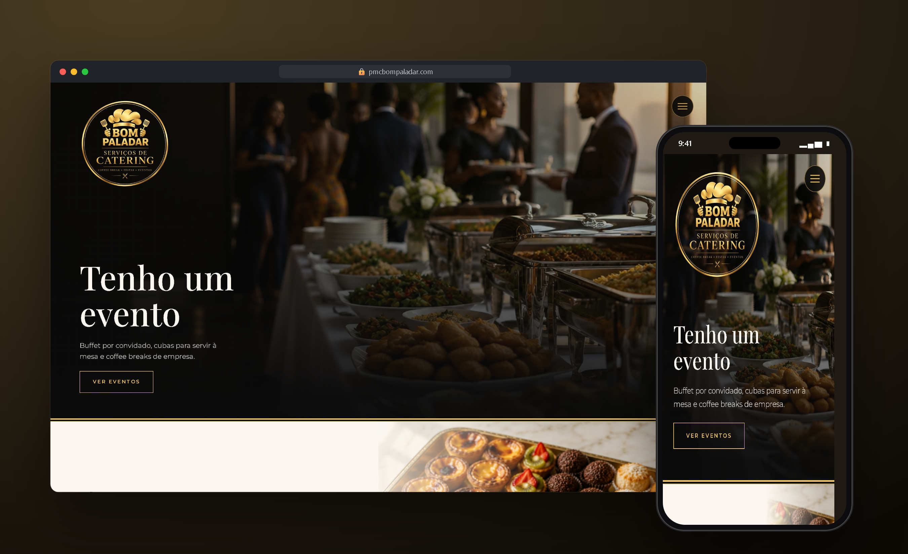
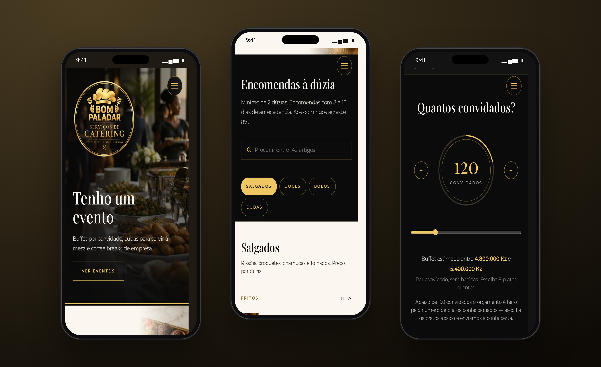
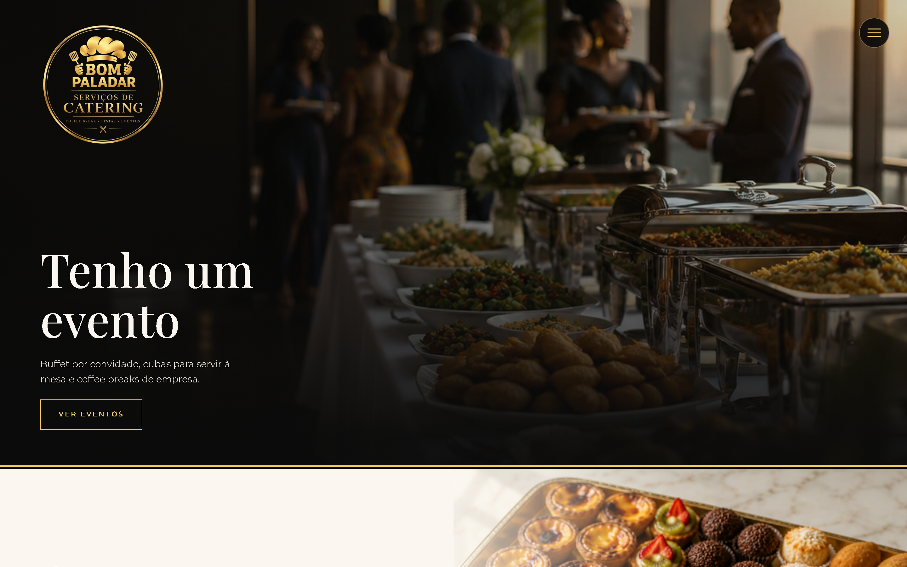

# Bom Paladar · Catering Website

Website for Bom Paladar, a catering business in Luanda, Angola.

 

## Highlights

- **Catalog ordering** by the dozen.
- **Buffet budget calculator:** enter the number of guests, get a price range, send it on WhatsApp in one tap.
- **Events showcase** for buffets and coffee breaks.
- **Mobile first** and responsive.

## Mobile

## Desktop

## Stack

  

## My role

Full-stack development: requirements, UI, front-end, back-end, deploy and support in production.

## Source code

The source code is private because it belongs to the client. I am happy to walk through the architecture and the code in an interview.

---

Built by **[Erick Rodrigues](https://github.com/Erickrodrigues05)**, Full-Stack Developer · [erickrodrigues781@gmail.com](mailto:erickrodrigues781@gmail.com)

